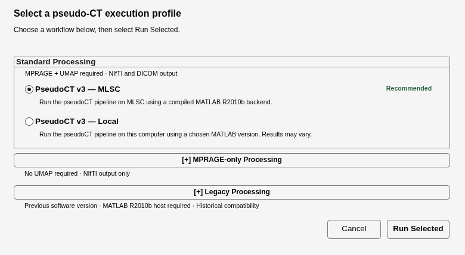
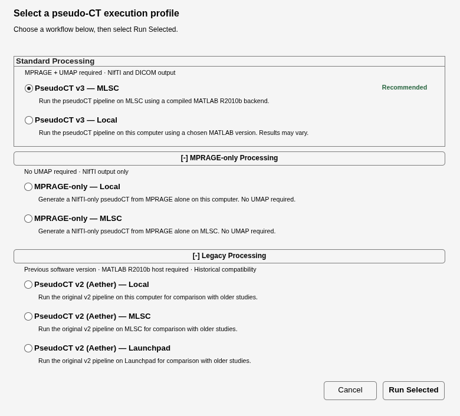

# pseudoCT_standalone

Atlas-based pseudoCT generation for PET/MR attenuation correction from a T1-weighted MPRAGE, using the SPM8-based method of Izquierdo-Garcia et al. (*Journal of Nuclear Medicine*, 2014;55(11):1825–1830).

For Martinos users, use the centrally deployed version and the [PseudoCT User Guide](https://mscipio.github.io/pseudoCT_standalone/help/) for the complete workflow. For external installation requirements and configuration, see [Installation](docs/installation.md). Method, evidence, and limitations are summarized in [Scientific notes](docs/scientific-notes.md).

## Quick start (Martinos)

Use the deployed version under `/usr/pubsw/packages/mrpet/standalone_apps/PseudoCT/`. Add the installation root to MATLAB's path:

```matlab
addpath('/usr/pubsw/packages/mrpet/standalone_apps/PseudoCT/pseudoCT_standalone-latest')
% To pin an installed numbered release, replace <version> with its number:
% addpath('/usr/pubsw/packages/mrpet/standalone_apps/PseudoCT/pseudoCT_standalone-<version>')
run_pseudo_CT
```

Select **PseudoCT v3 — MLSC** (the recommended default) for routine processing. **PseudoCT v3 — Local** remains available and uses the same R2010b-compiled current-science payload; the MATLAB interpreter coordinates local preparation, normalization, and finalization. The accepted MLSC executable described in the provenance record is current-lineage PseudoCT v3 compiled using MATLAB R2010b, not the historical Aether v2 implementation. MATLAB must remain open through processing and remote monitoring/finalization.

## Profiles and release

The selector groups choices under **Standard Processing**, **MPRAGE-only Processing**, and **Legacy Processing**. Standard choices are **PseudoCT v3 — MLSC** (`mlsc-current`, recommended default) and **PseudoCT v3 — Local** (`local-current`); MPRAGE-only choices are **MPRAGE-only — Local** and **MPRAGE-only — MLSC**. In v3.2.0-rc2, `mlsc-mprage-only` uses the same current-lineage R2010b compiled artifact and fail-closed artifact contract as `mlsc-current`; only its input, output, and GUI policies differ. The three historical choices remain **PseudoCT v2 (Aether) — Local**, **PseudoCT v2 (Aether) — MLSC**, and **PseudoCT v2 (Aether) — Launchpad**. Legacy profiles require a MATLAB R2010b host and are retained for historical compatibility. Neither current MLSC profile silently falls back to a legacy Aether implementation. See [Installation](docs/installation.md) for profile labels, descriptions, availability, and requirements.

### Profile selector screenshots



*Figure 1. Standard Processing in the current installed MATLAB selector (R2026a Update 2), before processing starts.*



*Figure 2. All selector groups expanded, showing both MPRAGE-only choices and the three historical Aether choices.*

The source version metadata is **3.2.0** (current candidate v3.2.0-rc2); no production deployment is claimed. v3.0.2 is the previous published archive in the preserved [release history](CHANGELOG.md); v3.0.0 and v3.0.1 remain withdrawn. The accepted job 10515471 result is dataset-specific, its association with the cited executable is unverified, and the original dirty-source fingerprint was not independently reconstructed. v3.2.0-rc2 changes profile selection/dispatch only: the R2010b compiled payload is reused unchanged and no new scientific processing is claimed. Always inspect generated QC before using an attenuation map.

The shared orchestration API separates local `validate` from authenticated
`submit`. Validation resolves each MPRAGE and its positionally paired UMAP
without login; submit rechecks the resolved inputs/artifacts and then performs
one MLSC login/account selection or the existing Launchpad login. The standalone
MAT v5 CLI uses the neutral request/result v2 schemas; see [Headless CLI](docs/headless-cli.md)
for the validate→submit contract and examples.

## Development and distribution boundary

The agreed package architecture has one interpreted MATLAB orchestration layer shared by the GUI and headless CLI, one shared compiled current-science payload for local-current and MLSC-current, and an isolated immutable historical payload. Its package-root layout is exactly:

The source-only QC colormap resolver correction points to `src/qc/`; it was not rebuilt into the existing `compiled/current/` artifact, which remains the recorded T032 payload.

- `bin/`
- `orchestration/`
- `compiled/legacy-v2.0.0/`
- `compiled/current/`
- `external/`
- `manifests/`
- `README.md`

This is the distribution target, distinct from the development checkout. The checkout keeps API, CLI, GUI, orchestration, backend, configuration, I/O, QC, and scientific build-source ownership under `src/`; build/install/maintenance tools are in `scripts/`, and tests/manual tools are in `tests/`. `run_pseudo_CT.m` is a thin public dispatcher. Scientific source under `src/science/` is compiler input, not an interpreted current-science fallback; local-current and MLSC-current execute the identical `compiled/current/` payload. The current payload was rebuilt after the shared-orchestration changes with MATLAB R2010b/Compiler 4.14; its build/resource manifests are paired with the payload, and this cleanup does not rebuild it. SSH2 is at `external/ssh2_v2_m1_r5/`, the source tree invoked by MLSC/Launchpad transport; its identity/hash is unchanged. DICOM input conversion is a separate interpreted orchestration need: the existing lifecycle calls the staged `external/dicom2nifti-1.2.5/` `dcm2nii` facade before backend processing. Only DICOM conversion requires SPM8 r6313 at runtime. Setup initially adds the three `src/science/overrides/` files first, preserving the historical path order; during DICOM conversion the pinned converter API adds configured SPM8 at path-begin, so SPM8 `spm_dicom_convert` remains effective. `correct_aliasing` v0.4.0, selected SPM sources, and the overrides remain pinned build inputs; compiled current execution neither requires nor adds interpreted `correct_aliasing` or science source paths. The file contents of the unused root smoothing candidate and legacy override directory were removed after caller/path verification; empty directory shells may remain in this shared development checkout. Superseded root build-output contents were removed; the canonical `compiled/current/` and historical `compiled/legacy-v2.0.0/` payloads remain.

`Batch_atlas` is a compiled-science runtime resource consumed by the current payload; the legacy payload keeps its distinct legacy `Batch_atlas/`. FreeSurfer (`mri_normalize`) and MATLAB/MCR, MATLAB Java, Slurm/PBS, shells, and other site tools are external system/runtime requirements, not vendored processing sources. The repository's local staged copies and hashes do not grant redistribution rights: unresolved provenance, complete notices, compatibility, and license questions remain no-public-packaging gates. See [Installation and requirements](docs/installation.md) and [`dependencies.lock.json`](dependencies.lock.json) for source evidence, exact invocation boundaries, and current artifact hashes.
