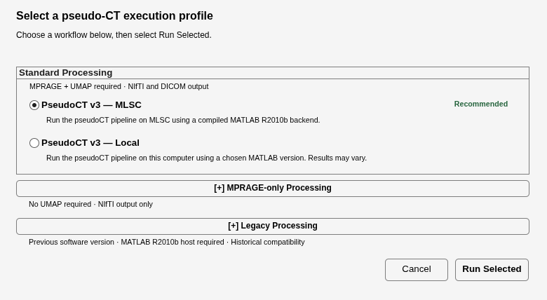
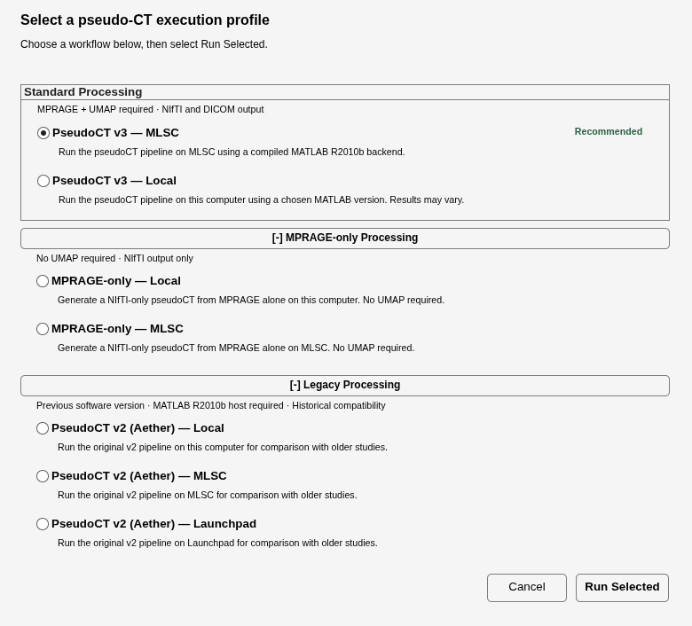

# pseudoCT_standalone

Atlas-based pseudoCT generation for PET/MR attenuation correction from a T1-weighted MPRAGE, using the SPM8-based method of Izquierdo-Garcia et al. (*Journal of Nuclear Medicine*, 2014;55(11):1825–1830).

For Martinos users, use the centrally deployed version and the [PseudoCT User Guide](https://mscipio.github.io/pseudoCT_standalone/help/) for the complete workflow. For external installation requirements and configuration, see [Installation](docs/installation.md). Method, evidence, and limitations are summarized in [Scientific notes](docs/scientific-notes.md).

## Quick start (Martinos)

Use the deployed version under `/usr/pubsw/packages/mrpet/standalone_apps/PseudoCT/`. Add the installation root to MATLAB's path:

```matlab
addpath('/usr/pubsw/packages/mrpet/standalone_apps/PseudoCT/pseudoCT_standalone-latest')
% To pin an installed numbered release, replace <version> with its number:
% addpath('/usr/pubsw/packages/mrpet/standalone_apps/PseudoCT/pseudoCT_standalone-<version>')
run_pseudo_CT
```

Select **PseudoCT v3 — MLSC** (the recommended default) for routine processing. **PseudoCT v3 — Local** remains available; it uses the MATLAB version you choose, and results may vary. The accepted MLSC executable described in the provenance record is current-lineage PseudoCT v3 compiled using MATLAB R2010b, not the historical Aether v2 implementation. MATLAB must remain open through processing and remote monitoring/finalization.

## Profiles and release

The selector groups choices under **Standard Processing**, **MPRAGE-only Processing**, and **Legacy Processing**. Standard choices are **PseudoCT v3 — MLSC** (`mlsc-current`, recommended default) and **PseudoCT v3 — Local** (`local-current`); MPRAGE-only choices are **MPRAGE-only — Local** and **MPRAGE-only — MLSC**. In v3.2.0-rc2, `mlsc-mprage-only` uses the same current-lineage R2010b compiled artifact and fail-closed artifact contract as `mlsc-current`; only its input, output, and GUI policies differ. The three historical choices remain **PseudoCT v2 (Aether) — Local**, **PseudoCT v2 (Aether) — MLSC**, and **PseudoCT v2 (Aether) — Launchpad**. Legacy profiles require a MATLAB R2010b host and are retained for historical compatibility. Neither current MLSC profile silently falls back to a legacy Aether implementation. See [Installation](docs/installation.md) for profile labels, descriptions, availability, and requirements.

### Profile selector screenshots



*Figure 1. Standard Processing in the current installed MATLAB selector (R2026a Update 2), before processing starts.*



*Figure 2. All selector groups expanded, showing both MPRAGE-only choices and the three historical Aether choices.*

The source version metadata is **3.2.0** (current candidate v3.2.0-rc2); no production deployment is claimed. v3.0.2 is the previous published archive in the preserved [release history](CHANGELOG.md); v3.0.0 and v3.0.1 remain withdrawn. The accepted job 10515471 result is dataset-specific, its association with the cited executable is unverified, and the original dirty-source fingerprint was not independently reconstructed; see the [artifact provenance record](RELEASE_PROVENANCE_v3.1.0.md). v3.2.0-rc2 changes profile selection/dispatch only: the R2010b compiled payload is reused unchanged and no new scientific processing is claimed. Always inspect generated QC before using an attenuation map.
